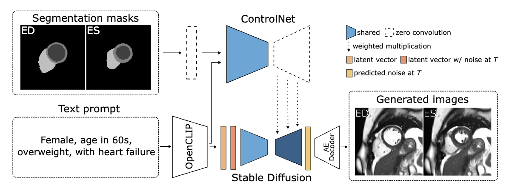
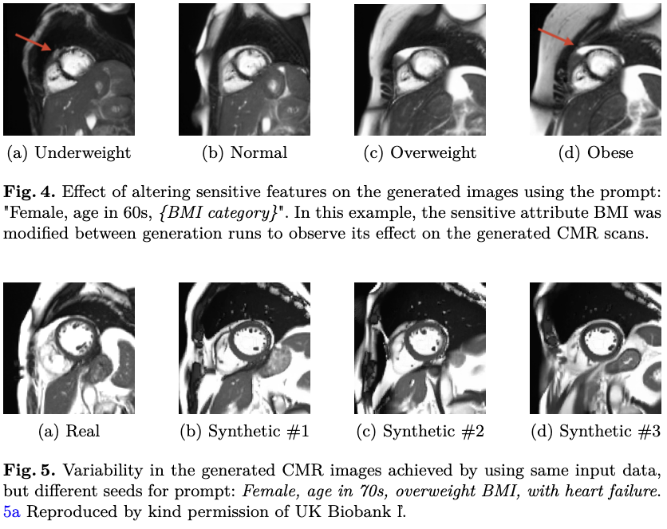
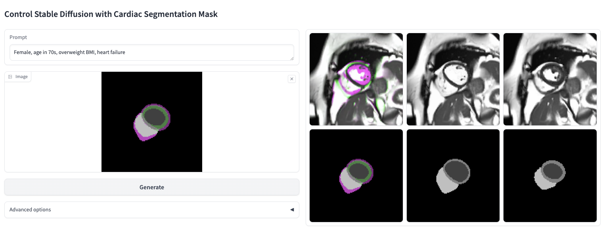

# Fairness-Aware Data Augmentation for Cardiac MRI using Text-Conditioned Diffusion Models
[](https://arxiv.org/abs/2403.19508)
[](#)
[](#)
[](#)

🎉 **Update:** Paper accepted at the **Fairness of AI in Medical Imaging Workshop @ MICCAI 2025**!

> [Skorupko, G., Osuala, R., Szafranowska, Z., Kushibar, K., Dang, V. N., Aung, N., ... & Gkontra, P. (2025, September). Fairness-Aware Data Augmentation for Cardiac MRI Using Text-Conditioned Diffusion Models. In MICCAI Workshop on Fairness of AI in Medical Imaging (pp. 63-73). Cham: Springer Nature Switzerland.](https://link.springer.com/chapter/10.1007/978-3-032-05870-6_7)





---

## 🚀 Overview  

This work explores how **text-conditioned diffusion models** can help **reduce bias** and **tackle data scarcity** in cardiac MRI–based **heart failure prediction**.  

🧩 We focus on **fairness-aware synthetic data generation**, where diffusion models help balance underrepresented subgroups across **sex**, **age**, and **BMI**.

---

## 🧠 Major Findings  

✨ **Key Takeaways:**
- 🧍‍♀️🧍‍♂️ Traditional sampling strategies had **limited effect** on fairness.  
- 💨 **Diffusion-based augmentation** improved **performance across diverse subgroups**, especially for underrepresented patients.  
- ⚖️ Achieved **higher balanced accuracy** and **lower bias** across sex, age, and BMI.

---

**Synthetic images conditioned on BMI**



---

## ⚙️ Setup  

Create a new conda environment with
```
conda env create -f environment.yaml
conda activate debiasing-cardiac-mri
```

## ControlNet model training
Diffusion model training is based on a very well documented [ControlNet](https://github.com/lllyasviel/ControlNet) repo. 

Before training, ensure that the pretrained Stable diffusion 2.1 model is downloaded: 
["v2-1_512-ema-pruned.ckpt"](https://huggingface.co/stabilityai/stable-diffusion-2-1-base/tree/main)
After download, run
```
python tool_add_control_sd21.py
```
to attach the ControlNet branch to the vanilla Stable Diffusion model.


To train the Stable Diffusion model with ControlNet run:
```
python train.py
```

For more detailed instructions, go to (https://github.com/lllyasviel/ControlNet/blob/main/docs/train.md)

## Synthetic dataset generation
When your diffusion model fine-tuning is ready, you can generate the unbiased synthetic dataset with the following script
```
python generate_synthetic_dataset.py
```
You can choose one of the generation methods:
 - `generate_synthetic_copy` use real prompts and masks from the training dataset (used in the paper)
 - `generate_random_prompt_dataset` use randomly generated prompts and randomly selected masks from corresponding labels (e.g. healthy or heart failure)

## Interactive generation
You can run a Gradio app to host your model and easily generate images with different prompts and masks.
```
python gradio_mask2image.py
```



In this application, cardiac masks are stacked as RGB images, thus the raw output from the model is an RGB image as well. Two columns on the right display unstacked ED and ES frames.


# Downstream task: Classification model training

The framework allows to train classification models using different cardiac MRI inputs

## Supported training inputs:
 - cineMRI sequence training (4-chamber and short-axis views) (3D data)
 - volume short-axis data (3D)
 - single slice input (2D)
 - single timeframe input (2D)
 - stacked end-diastole and end-systole frames as RGB image (2D)

# Fairness

### Training
Framework supports weighted sampling method based on one or more sensitive attributes including sex, age and BMI.

### Evaluation
Each trained model is evaluated in terms of fairness with following metrics:
 - Demographic Parity
 - Equalized Odds
 - Equal Opportunity

Also, each sensitive subgroup is evaluated independently with standard performance metrics.

In the paper, we focus on Balanced Accuracy metric computed for each subpopulation.

Fairness metrics are provided by `fairlearn` library.

# Usage

First, setup the `config.yaml` with training data type, disease to predict, batch size etc.

Then, you can run training with:
```
python cardioai/training.py
```

Optionally, you can specify GPU id for the training or directory to store the experiment logs:
```
python cardioai/training.py --gpu_id 0 --experiment_dir ./logs
```

After the training, model evaluation report is generated in the experiment directory.

## Results reproduction

To reproduce the experiments from paper and obtain full performance and fairness reports with std values for 8 repeated runs:
```
./repeated.sh
```

# Structure

The codebase includes several Python scripts and Jupyter notebooks, as well as configuration files and shell scripts.

- cardioai/kfold_training.py: This script runs k-fold cross-validation training on the data.
- cardioai/training.py: This script handles the training process for a single fold.
- cardioai/compile_results.py: This script compiles the results from the k-fold cross-validation.
- cardioai/test.py: This script handles the testing process.
- cardioai/visualise.py: This script provides functions for visualizing the data and the results.
- fair_metrics.ipynb: This Jupyter notebook calculates and visualizes fairness metrics.
- kfold.sh: This shell script runs the k-fold training script in the background.
- config.yaml: This file contains configuration parameters for the experiment.


To run the k-fold cross-validation training, use the kfold.sh script. You need to provide the GPU ID as an argument.

# Configuration

You can adjust the parameters of the experiment in the `config.yaml` file. The parameters include the number of epochs, batch size, learning rate, and model type, among others.

# Citation

If you find the paper or repository helpful please cite our work:
> [Skorupko, G., Osuala, R., Szafranowska, Z., Kushibar, K., Dang, V. N., Aung, N., ... & Gkontra, P. (2025, September). Fairness-Aware Data Augmentation for Cardiac MRI Using Text-Conditioned Diffusion Models. In MICCAI Workshop on Fairness of AI in Medical Imaging (pp. 63-73). Cham: Springer Nature Switzerland.](https://link.springer.com/chapter/10.1007/978-3-032-05870-6_7)

```bibtex
@inproceedings{skorupko2025fairness,
  title={Fairness-Aware Data Augmentation for Cardiac MRI Using Text-Conditioned Diffusion Models},
  author={Skorupko, Grzegorz and Osuala, Richard and Szafranowska, Zuzanna and Kushibar, Kaisar and Dang, Vien Ngoc and Aung, Nay and Petersen, Steffen E and Lekadir, Karim and Gkontra, Polyxeni},
  booktitle={MICCAI Workshop on Fairness of AI in Medical Imaging},
  pages={63--73},
  year={2025},
  organization={Springer}
}
```


